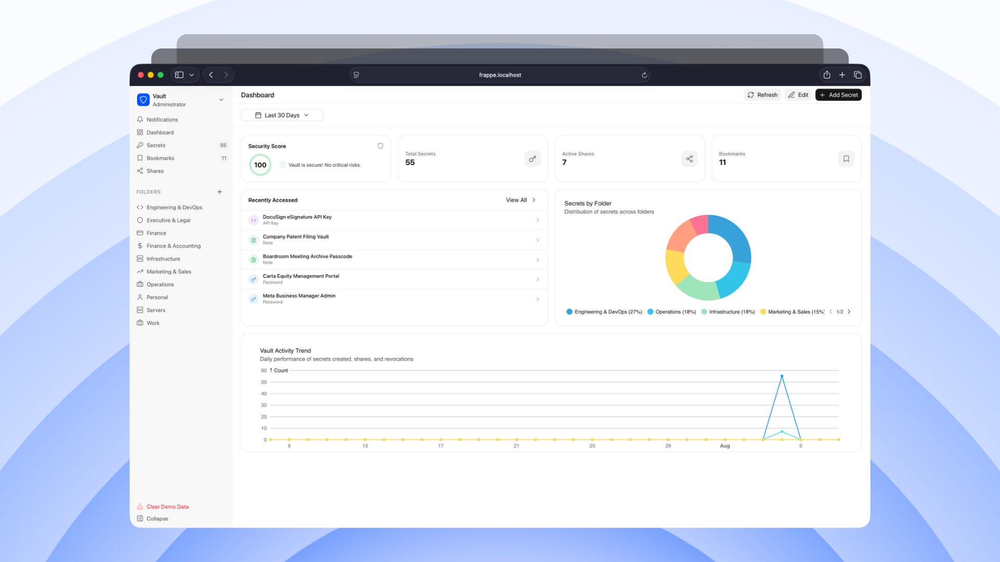

<p align="center"></p>



[](https://frappe-playground.lubus.in/?name=Frappe%20Vault&onboarding=0&apps=frappe_vault&path=/vault)
[](https://chromewebstore.google.com/detail/frappe-vault/ljnpblaghkeddioeknlgcoolmomofjlj)

# Frappe Vault

Secure secrets and password management application for the Frappe Framework and ERPNext. Store, organize, share, and audit sensitive credentials through a modern dedicated web application or standard Frappe Desk.

## Features

- **Multi-Type Secret Storage**: Securely store passwords, live TOTP 2FA keys, API keys, SSH keys, notes, credit cards, database credentials, and private file attachments.
- **Dedicated Web Portal (`/vault`)**: Modern single-page application built with Vue 3 and Frappe UI with dark/light themes and persistent resizable columns.
- **Nested Tree-Based Folders**: Organize secrets into hierarchical parent/child folders with customizable icons and collapsible tree navigation in the sidebar.
- **Granular Sharing & Cascade Permissions**: Share secrets or entire folders with users or roles across 4 permission levels (`View Only`, `View & Copy`, `Edit`, `Full Control`), with expiration dates and subfolder permission cascading.
- **One-Time Secure Links**: Share sensitive credentials externally using expiring, view-limited, passphrase-protected links.
- **In-App User Management & Invitations**: Invite team members via email directly from the `/vault` settings, assign roles, or manage existing Frappe users.
- **Security Health Dashboard**: Real-time password strength scoring, vulnerability insights, and rotation alerts for stale credentials.
- **Companion Browser Extension**: Official Chromium extension for automatic domain matching, form autofill, and quick TOTP retrieval.
- **Audit Logging & Maintenance**: Comprehensive access audit logs, automated password expiry reminders, and background cleanup tasks.
- **Full REST API**: Whitelisted endpoints for browser extensions, automation scripts, and external integrations.

## Compatibility

| Vault Branch | Stability | Frappe Branch |
|---|---|---|
| `main` (`v1.x`) | **Stable** | `v15.x` & `v16.x` |
| `develop` (`future/v2.x`) | **Unstable** | `develop` |

## Quick Start & Installation

### Prerequisites

- Frappe Framework v15+ or v16+
- An active Frappe / ERPNext site

### Standard Installation

```bash
# Get the app
bench get-app https://github.com/lubusIN/frappe-vault.git

# Install on your site
bench --site your-site.local install-app frappe_vault

# Run migrations
bench --site your-site.local migrate
```

Once installed, users with the **Vault User** role can access the portal directly at:
```
https://your-site.local/vault
```

## Documentation

For in-depth guides and references, explore our dedicated documentation:

| Guide | Description |
|---|---|
| **[User Guide](docs/user-guide.md)** | Step-by-step instructions for managing secrets, organizing folders, internal sharing, one-time public links, security dashboard, and browser extension setup. |
| **[Technical Reference](docs/technical-reference.md)** | System administration, role configuration (`Vault User` vs `Vault Admin`), site encryption key management, background maintenance jobs, REST API reference, DocType data models, and frontend development. |

## Security

- **At-Rest AES Encryption**: Sensitive credential fields are encrypted using Frappe's built-in AES encryption (`__Auth` table).
- **Row-Level Security**: Server-side query conditions enforce strict owner and tenant isolation across secrets and folders.
- **Audit Trails**: Decryption, views, and sharing modifications generate immutable audit log records.
- **Rate-Limited Public Links**: One-time link redemption is rate-limited to prevent brute-force attacks.

### Reporting Vulnerabilities

Please do not report security vulnerabilities through public GitHub issues. If you identify a security issue, contact us privately at [https://lubus.in/contact-us](https://lubus.in/contact-us).

## Support

Frappe Vault is a free and open-source project maintained by [LUBUS](https://lubus.in/).

For bugs, feature requests, and community support, please open an issue in the [GitHub Issue Tracker](https://github.com/lubusIN/frappe-vault/issues). Our team reviews community issues based on bandwidth and roadmap priorities.

If your organization requires dedicated support, custom integrations, or SLA-backed assistance, please contact [LUBUS](https://lubus.in/contact-us).

## Contributing

Contributions are welcome! Please feel free to submit issues or Pull Requests. When contributing code, ensure tests pass:

```bash
bench --site your-site.local run-tests --app frappe_vault
```

## More Frappe Tools

Explore more open-source tools we're building for the Frappe ecosystem:

<table>
  <tr>
    <td width="50%" valign="top">
      <a href="https://github.com/lubusIN/frappe-local">
        
      </a>
      <br>
      Create and manage local Frappe benches and sites visually.
    </td>
    <td width="50%" valign="top">
      <a href="https://github.com/lubusIN/frappe-playground">
        
      </a>
      <br>
      Run Frappe entirely in your browser.
    </td>
  </tr>

  <tr>
    <td width="50%" valign="top">
      <a href="https://github.com/lubusIN/frappe-brewery">
        
      </a>
      <br>
      Discover community-built apps for Frappe.
    </td>
    <td width="50%" valign="top">
      <a href="https://github.com/lubusIN/wp-frappe-data-store">
        
      </a>
      <br>
      Connect WordPress and Frappe with a React data store.
    </td>
  </tr>
</table>

[Explore all LUBUS projects →](https://github.com/lubusIN)

## Meet Your Artisans

[LUBUS](https://lubus.in/?utm_source=github&utm_medium=open-source&utm_campaign=frappe-vault) is a web design and engineering agency based in Mumbai.

<a href="https://cal.com/lubus">

</a>

## License

Frappe Vault is open-source software licensed under the [MIT License](LICENSE).
