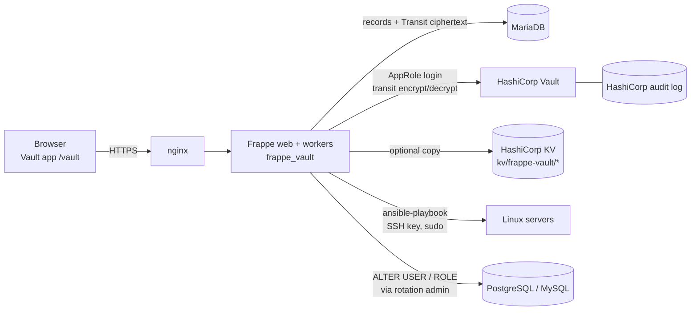
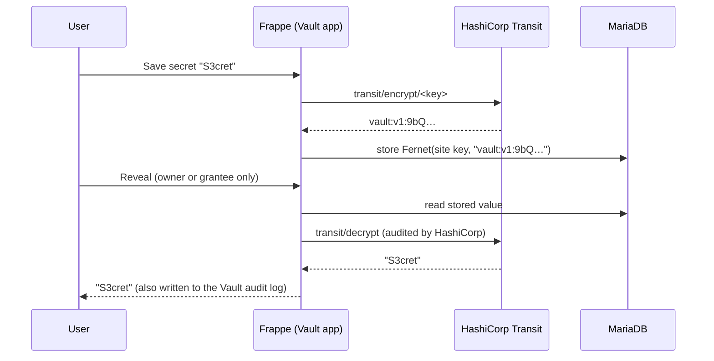

# Security Architecture

How Frappe Vault keeps secret values away from people who were not given them, including administrators, and why secret values are encrypted with HashiCorp Vault's Transit engine.

## Table of Contents

- [Components](#components)
- [How a Secret Is Stored and Read](#how-a-secret-is-stored-and-read)
- [Why HashiCorp Transit](#why-hashicorp-transit)
- [Who Can See a Secret's Value](#who-can-see-a-secrets-value)
- [Other Protections](#other-protections)
- [Known Limitations](#known-limitations)

Related: [HashiCorp Setup](hashicorp-setup.md) · [Rotation Setup](rotation-setup.md) · [Operations](operations.md)

## Components

| Component | Role |
|---|---|
| Frappe Vault | Keeps the records, enforces who may see a value, writes the Vault audit log, runs rotation jobs. |
| HashiCorp Transit | Holds the key that encrypts every secret value. The key never leaves HashiCorp. |
| HashiCorp KV (optional) | Keeps a copy of selected secrets for other systems to read. |
| Ansible | Changes Linux account passwords on remote servers. |
| Database drivers | Change PostgreSQL, MySQL/MariaDB and MongoDB account passwords. |

## How a Secret Is Stored and Read

1. Frappe sends the value to HashiCorp's `transit/encrypt` endpoint and gets back `vault:vN:…` ciphertext.
2. Frappe stores that ciphertext in its `__Auth` table, encrypted again with its own site key, as for any Password field.
3. To reveal a value, Frappe checks the user is entitled to it, then sends the ciphertext to `transit/decrypt`.

The wrapping happens in `TransitPasswordsMixin._save_passwords`, after `validate` and `before_save`. Strength checks, reuse checks, password history and rotation logic therefore still see the plaintext.

Transit is turned on per site in `site_config.json` (`vault_transit_key`), not in Vault Settings. A Frappe administrator cannot switch it off from the web UI.

Failure is closed: when Transit is on and HashiCorp cannot encrypt a value, the value is not stored. When HashiCorp cannot decrypt, the app shows an error, never a blank value.

## Why HashiCorp Transit

Frappe encrypts Password fields with one site-wide key in `site_config.json`, on the same server as the database. Anyone with both a database dump and that file can read every secret. We considered three ways to improve on this.

| Option | How it works | What it protects against | Decision |
|---|---|---|---|
| **A. Site key in HashiCorp** | Frappe reads its site key from HashiCorp at startup instead of `site_config.json`. | A stolen database plus config file. It does not protect against code running inside Frappe: the key is in process memory and decrypts silently. It also needs a patch to Frappe core. | Rejected |
| **B. Transit** (encryption as a service) | HashiCorp encrypts each value with a key that never leaves it. Frappe stores only `vault:vN:…` ciphertext. | A stolen database plus config file yields nothing. Every decryption is a HashiCorp request: logged outside Frappe, revocable at once, rate-limitable. Key rotation is built in. | **Chosen** |
| **C. Zero-knowledge** | The browser encrypts secrets with per-user keys that the server never sees. | Even a fully compromised server. But the server can then no longer rotate Linux or database passwords, which must be applied server-side. | Later, for personal secrets |

### Reasons for Transit

- **The key never leaves HashiCorp.** Nothing in Frappe's database, config or memory can decrypt a secret on its own.
- **Decryption is an event, not a capability.** Each reveal, rotation or sync is a request that HashiCorp records in its own audit log. Frappe administrators cannot edit that log from the app.
- **Containment is one command.** If the Frappe server is compromised, revoking the AppRole stops all decryption at once, even for an attacker who already has a copy of the database.
- **Rotation keeps working.** Unlike zero-knowledge encryption, the server can still decrypt the values it must apply to Linux servers and databases.
- **Key rotation is built in.** The key can rotate on a schedule. Old key versions still decrypt; new writes use the newest version.
- **Low cost to add.** If HashiCorp already runs for KV sync, Transit adds one engine, one key and one narrow policy.

## Who Can See a Secret's Value

Only people who were given the secret:

- its owner;
- the owner of its folder;
- holders of an active share on the secret, on its folder, or on a parent folder shared with "cascade".

Vault Admin, System Manager and Administrator can manage records, but they are not entitled to the values.

| Path to a value | Control | Status |
|---|---|---|
| Reveal in the app | Reveal check (grantees only). Every reveal is written to the Vault audit log. | Enforced |
| Admin shares a secret or folder with themselves, a colleague or a role | Only someone who already has the item may grant it to others (`require_access_entitlement`). | Blocked |
| Admin moves a secret into their own folder, moves a folder under theirs, or changes an owner | Same rule, enforced in the record controllers. This covers the app, desk, REST and data import. | Blocked |
| `frappe.client.get_password` on Vault records | Overridden to refuse Vault Secret, Vault One Time Link and Vault Settings. | Blocked |
| Database dump plus `site_config.json` | Values are Transit ciphertext. | Protected |
| Redirecting HashiCorp sync to another server | Logged as "Settings Changed" and sent to all Vault Admins. | Detected |
| System Manager runs code in the System Console | Can decrypt. Each decryption appears in HashiCorp's audit log. | Detected, not prevented |
| Root on the Frappe server | Controls Frappe, and also HashiCorp if it runs on the same host. | Not covered |

Install, migrate and patch runs are exempt from the entitlement rule, so fixtures and migrations still work.

## Other Protections

- State-changing API endpoints accept only POST, so Frappe's CSRF check always applies.
- One-time links fail closed. A link whose passphrase cannot be decrypted refuses to open; it does not open without the passphrase.
- Only Vault Admins can purge the audit log.
- Linux rotation validates hostnames and account names. It marks every value passed to Ansible as `!unsafe`, so Ansible does not template it. This blocks command injection through secret fields.
- A Database or Linux secret can only be rotated together with its server, never in Vault alone. This prevents the stored password from drifting away from the real one.
- Changes to sensitive Vault Settings fields create a "Settings Changed" audit entry and a notification to Vault Admins.

## Known Limitations

- **Same host.** If HashiCorp runs on the same server as Frappe, root on that server can reach both. Run HashiCorp on its own host with separate administrators.
- **Code execution inside Frappe.** Anyone who can run arbitrary code in Frappe (for example a System Manager with the System Console) can still decrypt. Every such decryption is recorded by HashiCorp. Keep System Manager for break-glass accounts only.
- **Local audit log.** A local HashiCorp audit log can be edited by root. Send it to a separate log store.
- **Availability.** While HashiCorp is sealed or stopped, Vault cannot show or save secrets. See [Operations](operations.md#when-hashicorp-is-down-or-sealed).
- **Backups.** A Frappe backup alone cannot restore any secret. See [Operations](operations.md#backup-and-recovery).
